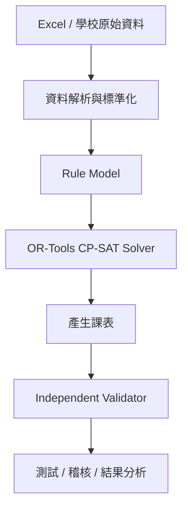
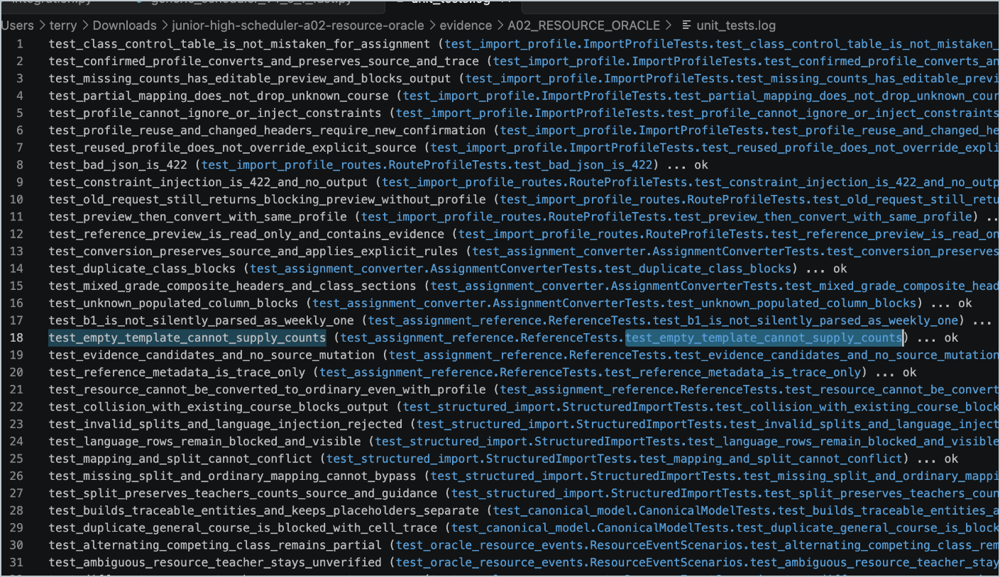
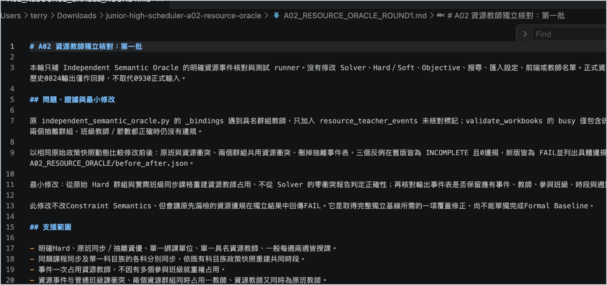

# 國中智慧排課系統
### 從「排得出課表」到「如何證明課表真的正確」

> 一個以真實國中排課問題為背景，結合 Constraint Programming、資料工程、軟體驗證與 AI 協作開發的排課系統專案。

---

# 1. 專案摘要

| 項目 | 內容 |
|---|---|
| 專案類型 | 國中課表排程 / Constraint Optimization |
| 核心技術 | Python、OR-Tools CP-SAT、Excel I/O |
| 開發方式 | AI-assisted development |
| 我的角色 | 問題定義、需求分析、規格設計、技術決策、測試與驗收 |
| AI 角色 | 程式實作、重構、測試與文件整理輔助 |
| 專案狀態 | 持續開發中 |
| 目前測試 | 完整回歸 130 項測試通過 |
| 已完成驗證 | 藝才課程覆寫與固定時段：14 情境、10 次實際求解通過 |
| 目前重點 | Formal Baseline、Semantic Oracle、規則泛化與可靠性驗證 |

---

# 2. 我想解決什麼問題？

學校排課乍看只是把課程填進課表，但實際上需要同時處理：

- 教師不能撞堂
- 班級不能撞堂
- 教師不可排時段
- 固定課程
- 特殊班級
- 同步課程
- 特殊教師限制
- 課程節數
- 課程分散需求
- 大量 Excel 與自然語言規則

因此，它本質上是一個大型的：

**Constraint Satisfaction / Optimization Problem**

我最初的目標只是：

> 「讓系統自動產生合法課表。」

但開發愈深入，我發現更困難的問題其實是：

> **系統說課表正確，我要怎麼知道它真的正確？**

這也逐漸成為整個專案最重要的開發方向。

---

# 3. 系統架構



未來希望進一步形成：

```text
自然語言 / Excel / 文件
        ↓
LLM 輔助資料轉換層
        ↓
標準化資料
        ↓
規則引擎
        ↓
CP-SAT Solver
        ↓
Independent Validator
        ↓
課表
```

---

# 4. 開發中發現的關鍵問題

## A01｜Solver 與 Validator 可能一起判錯

早期架構中，Solver 與 Validator 共用部分解析邏輯。

這產生一個危險的情況：

> 如果原始規則在解析階段就被錯誤理解，Solver 可能依照錯誤規則排課，而 Validator 又使用相同的錯誤理解進行驗證。

最後兩者都可能顯示：

**PASS**

但這並不能證明原始校務需求真的被滿足。

這使我的開發重點從：

> 「系統能不能產生課表？」

逐漸轉向：

> **「我要如何獨立證明這張課表真的正確？」**

因此後續開始規劃 Semantic Oracle、Scenario Tests 與更獨立的驗證流程。

---

## A09｜求解時間可能被前一階段耗盡

系統部分求解流程會經過：

```text
stable
↓
full
```

我發現後續階段可能沿用前一階段已經消耗過的 deadline。

這可能造成：

- 後續 Solver 可用時間大幅縮短
- 表面看起來像 Solver 效能不佳
- 系統卻不一定明確報錯

這讓我理解到：

> **程式沒有 crash，不代表系統行為符合原始設計。**

---

## 規則泛化問題

部分早期規則可能依賴：

- 特定教師姓名
- 特定課程名稱

在單一學期可能可以運作，但換教師、換學期甚至換學校後，就可能失效。

因此後續方向是將具名規則逐步改造成：

**角色 / 資源 / Rule Model**

提升系統的可移植性與泛化能力。

---

# 5. 真實資料比 Solver 更困難

開發過程中，我逐漸發現：

> **真實學校資料本來就不是為程式設計的。**

實際資料可能包含：

- 不同欄位名稱
- 重複欄位
- Excel 自動產生 `.1`、`.2`
- 課程名稱括號與簡稱
- 同一概念有不同寫法
- Word / Excel 中的自然語言規則
- 特殊班級與教師例外
- 不完整或尚未核定資料

因此我開始認為：

> **資料解析與標準化，本身就是排課系統的重要核心。**

未來也希望研究利用 LLM 作為自然語言與標準化資料之間的輔助轉換層。

---

# 6. AI 協作開發方式

本專案採用 **AI-assisted development**。

我沒有把一句「幫我做一個排課系統」交給 AI 後直接接受結果，而是將大型問題拆成可以逐步驗證的小問題。

## 我負責

- 真實問題與需求定義
- 將校務規則轉換成可實作規格
- 判斷 Hard / Soft Constraint
- 系統架構與開發順序
- 技術方案決策
- 測試案例與反例設計
- 驗證 AI 實作是否符合需求
- 錯誤分析與最終驗收

## Codex / LLM 主要協助

- 程式碼實作
- 重構
- 自動化測試撰寫
- 技術方案探索
- 程式搜尋與分析
- 文件與重複性工程工作

我的基本原則是：

> **AI 產生程式碼 ≠ 程式碼正確。**

重要修改必須重新經過：

```text
需求
↓
實作
↓
測試
↓
反例
↓
驗證
↓
接受或修改
```

我把 AI 視為提高實作速度的協作工具，而問題定義、判斷與驗證仍由我負責。

---

# 7. 系統與開發證據

## 系統操作畫面

目前系統已建立從資料匯入、系統檢查、規則設定到求解的操作流程。


這張畫面證明專案並非只有後端模型，而已有可操作的系統介面。

---

## 測試與回歸紀錄

除了確認功能能執行之外，我也透過自動化測試與回歸驗證，避免修正一個問題後破壞其他既有規則。



目前其中一個已完成的小階段包含：

- 藝才課程覆寫與固定時段驗證：14 個情境
- 10 次實際 Solver 求解通過
- 完整回歸：130 項測試通過
- 前端語法檢查通過

---

## 問題分析與驗證紀錄

開發過程中，我除了記錄成功結果，也保留問題、證據、修改方式與驗證結果。



這些紀錄讓我能回頭回答：

- 為什麼要改？
- 原本哪裡有問題？
- 修改了什麼？
- 如何確認沒有造成新的錯誤？

而不是只以「程式現在跑得動」作為完成標準。

---

# 8. 專案目前的限制

我不希望把仍在進行中的工作描述成已完成成果。

目前仍在持續處理：

- Formal Baseline
- Semantic Oracle
- Scenario Tests
- Objective Vector 凍結
- Rule Model
- Benchmark
- Local Repair / LNS
- 輸入成本改善
- LLM-assisted input layer

因此目前不將本專案描述為：

> 「已完成並全面部署的全校自動排課產品。」

較準確的說法是：

> **已建立可運作的國中排課系統，並持續將重點由「產生課表」推進至「驗證課表是否可信」。**

完整開發 repository 目前維持非公開；此公開作品集僅提供經整理且不涉及校務敏感資料的系統畫面、測試與開發證據。

---

# 9. 下一步

近期開發方向：

```text
Formal Baseline
↓
Semantic Oracle
↓
Scenario Tests
↓
Objective Vector Freeze
```

後續預計延伸：

```text
Rule Model
↓
Benchmark
↓
Local Repair / LNS
↓
LLM-assisted Input
```

長期希望研究：

- Scheduling / Optimization
- AI-assisted scheduling
- 自然語言與 Excel → Constraint Model
- 不同學校規則的泛化
- 降低校務資料輸入成本
- 教育科技產品化與商業化可能性

---

# 10. 我從這個專案學到什麼？

一開始，我認為程式開發最重要的是：

> 「把功能做出來。」

但隨著專案變複雜，加上 AI 可以快速產生大量程式碼，我開始發現更困難的問題其實是：

- 問題有沒有定義正確？
- 規則到底代表什麼？
- AI 實作是否真的符合需求？
- 測試是不是也建立在錯誤假設上？
- 系統輸出的答案為什麼值得相信？

因此這個專案帶給我的最大收穫，不只是 Python 或 OR-Tools。

而是：

> **如何把一個充滿例外的真實問題逐步形式化，建立模型、找出錯誤，再用證據驗證結果。**

---

# 一句話總結

> **這個專案讓我學到的，不只是如何讓電腦排出一張課表，而是如何證明電腦產生的答案值得相信。**
